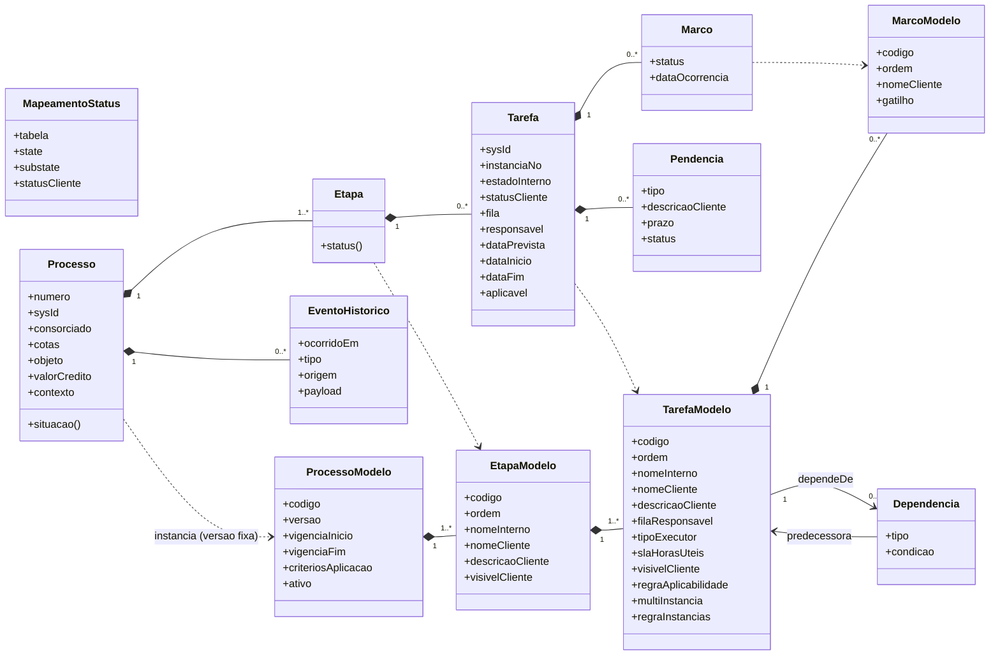
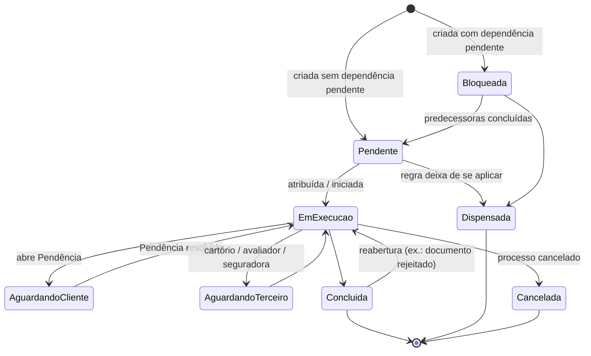

# Modelo de domínio — Acompanhamento do processo de utilização de crédito

> Escopo: utilização da carta de crédito de consórcio para aquisição de **imóveis urbanos**, desde a contemplação até o crédito utilizado, a garantia registrada e o encerramento.
> O app mostra ao cliente em que ponto está o processo. A fonte dos dados é o **ServiceNow**, que gerencia as filas do backoffice e da agência.
> Status: **proposta para validação**. O código vem depois de validar este modelo.
> Visões ArchiMate (PlantUML): [`arquitetura/`](arquitetura/README.md).

---

## 1. Ponto de partida e avaliação

Proposta original:

| # | Conceito | Papel |
|---|---|---|
| 1 | **Atendimento do Processo** | Entidade mais genérica. Engloba tudo o que a empresa faz (backoffice e agência) para o processo andar. |
| 2 | **Etapa / Categoria** | Agrupa tarefas relacionadas. Exemplo: *Análise técnica*. |
| 3 | **Tarefa** | Unidade de trabalho executada por alguém. Exemplo: *Análise de documentos*. |

**Conclusão:** a hierarquia está correta e coincide com as telas (Processo → Etapa → Tarefa). Para que processos complexos sejam **configuráveis em vez de programados**, o modelo precisa de quatro extensões:

1. **Separar a definição da execução.** De um lado, *templates* versionados (o processo "desenhado"). Do outro, *instâncias* (o processo de um cliente específico). Uma variante nova (planta, construção, reforma, FGTS) passa a ser só um template novo ou uma regra nova.
2. **Um quarto nível: Marco.** A tela 3 mostra passos *dentro* de uma tarefa ("Documentação enviada", "Análise da documentação"). Isso é a linha do tempo da tarefa, e precisa de uma entidade própria.
3. **Tirar a ordem e a condição da hierarquia.** A sequência e o paralelismo são definidos por **dependências** entre tarefas (um grafo acíclico). A inclusão de cada tarefa é definida por **regras de aplicabilidade**. Algumas tarefas podem repetir (**multi-instância**, por exemplo um pagamento para cada medição de obra).
4. **Uma camada de apresentação ao cliente.** O vocabulário interno (estados, filas e subestados do ServiceNow) é diferente do que o cliente vê. Existe um **status do cliente** fechado e pequeno, um mapeamento configurável, e há tarefas que **não aparecem** para o cliente (PLD, análise de capacidade de pagamento).

Também passam a ser entidades próprias:
- **Pendência:** o que o cliente precisa fazer. É o que mais gera valor no app.
- **Evento de histórico:** trilha imutável para auditoria e para as evidências regulatórias.

---

## 2. Glossário

| Termo (negócio) | Nome no código | Nome no ServiceNow (sugestão) | Definição |
|---|---|---|---|
| Modelo de processo | `ProcessoModelo` | `x_<esc>_processo_modelo` | Template versionado de um tipo de processo (ex.: *Utilização – Imóvel pronto v1*). |
| Modelo de etapa | `EtapaModelo` | `x_<esc>_etapa_modelo` | Agrupador de tarefas dentro de um modelo; define ordem de exibição e textos ao cliente. |
| Modelo de tarefa | `TarefaModelo` | `x_<esc>_tarefa_modelo` | Definição de uma unidade de trabalho: fila, executor, SLA, visibilidade, aplicabilidade, dependências, marcos. |
| Modelo de marco | `MarcoModelo` | `x_<esc>_marco_modelo` | Passo visível da linha do tempo de uma tarefa, disparado por uma transição de estado. |
| Mapeamento de status | `MapeamentoStatus` | `x_<esc>_mapa_status` | Tradução de `state`/`substate` do ServiceNow para `StatusCliente`. |
| **Processo** (Atendimento do Processo) | `Processo` | `x_<esc>_processo` (estende `task`) | Instância: o processo de utilização de crédito de um cliente para um objeto. Raiz do agregado. |
| Etapa | `Etapa` | *(não persistida; só agrupamento)* | Instância lógica de um `EtapaModelo`, com status **derivado**. |
| Tarefa | `Tarefa` | `x_<esc>_tarefa` (estende `task`, `parent` = Processo) | Instância de um `TarefaModelo`, que entra numa fila e é executada. |
| Marco | `Marco` | `x_<esc>_marco` ou derivado do histórico | Passo registrado da linha do tempo da tarefa, com data. |
| Pendência | `Pendencia` | `x_<esc>_pendencia` | Ação exigida do cliente (documento, assinatura, pagamento de diferença). |
| Evento de histórico | `EventoHistorico` | `sys_audit` / tabela de eventos | Fato imutável ("tarefa X passou para Y em T, por Z"). |
| Executor | `TipoExecutor` | campo choice | `BACKOFFICE`, `AGENCIA`, `CLIENTE`, `TERCEIRO` (cartório, avaliador, seguradora, vendedor). |
| Status do cliente | `StatusCliente` | campo calculado | Enum fechado (seção 5). |

---

## 3. Diagrama de classes



### Decisões de modelagem

- **Versão congelada:** o `Processo` guarda a versão do modelo que o criou. Mudar o template não altera processos em andamento. Migração só acontece de forma explícita.
- **Contexto do processo:** é um mapa de atributos usado nas regras: `segmento`, `finalidade`, `tipoImovel` (`PRONTO`, `PLANTA`, `TERRENO`, `CONSTRUCAO`, `REFORMA`), `usaFgts`, `quitaFinanciamento`, `regimeNormativo` (`CIRC_3432` | `RES_285`), `qtdCotas`, `qtdMedicoes`, `haSobra`. Toda a flexibilidade vem dessas variáveis e do template, sem código específico por variante.
- **Etapa não tem estado próprio:** o status dela é sempre calculado a partir das tarefas. Isso evita inconsistência e dispensa um registro de etapa no ServiceNow.
- **Objeto (imóvel):** é um value object com apelido ("Apto. Bela Vista"), endereço, matrícula e valor. Pode virar entidade quando houver mais de um imóvel por processo.

---

## 4. Ciclo de vida da Tarefa (estado interno)



No ServiceNow, esses estados usam `state` (Open, Work in Progress, Pending, Closed Complete, Closed Incomplete, Closed Skipped) junto com um `substate`. A tradução para o cliente fica na tabela de mapeamento (seção 7.3).

---

## 5. Status do cliente e regra de agregação

### 5.1 Enum fechado

| `StatusCliente` | Texto no app |
|---|---|
| `NAO_INICIADA` | Não iniciada |
| `EM_ANDAMENTO` | Em andamento |
| `AGUARDANDO_CLIENTE` | Aguardando você |
| `CONCLUIDA` | Concluída |
| `DISPENSADA` | Não se aplica *(normalmente fica oculta)* |
| `CANCELADA` | Cancelada |

A situação do processo mostrada na tela ("Situação da proposta: **Em andamento**") usa o mesmo enum.

### 5.2 Agregação (Tarefa → Etapa → Processo)

Considere apenas as tarefas **aplicáveis e visíveis**. Se uma regra precisar incluir tarefas internas, isso é configurado no `EtapaModelo`. As regras são avaliadas em ordem, e a primeira que casar vence:

1. Todas `CANCELADA` → **CANCELADA**
2. Todas em {`CONCLUIDA`, `DISPENSADA`} → **CONCLUIDA**
3. Alguma `AGUARDANDO_CLIENTE` → **AGUARDANDO_CLIENTE**
4. Alguma em {`EM_ANDAMENTO`, `CONCLUIDA`} → **EM_ANDAMENTO**
5. Caso contrário → **NAO_INICIADA**

O Processo aplica a mesma regra sobre as Etapas. Exemplo da tela 3: o marco *Documentação enviada* está concluído e *Análise da documentação* não foi iniciado, então a tarefa está **Em andamento**, a etapa *Análise técnica* está **Em andamento** e o processo está **Em andamento**.

### 5.3 Marcos

Um marco é **concluído** quando o gatilho dele ocorre. Gatilhos possíveis: transição de estado da tarefa, fechamento de uma Pendência, ou um evento externo como "laudo recebido". Exemplos de `gatilho`:

```yaml
- codigo: DOC_ENVIADA
  gatilho: { tipo: PENDENCIA_RESOLVIDA, pendencia: ENVIO_DOCUMENTOS }
- codigo: DOC_ANALISADA
  gatilho: { tipo: ESTADO_TAREFA, de: [EmExecucao], para: [Concluida] }
```

Um marco tem os status `NAO_INICIADA`, `EM_ANDAMENTO` e `CONCLUIDA`. O marco seguinte ao último concluído fica `EM_ANDAMENTO` se a tarefa estiver em execução. Senão, fica `NAO_INICIADA`, que é o caso da tela 3.

---

## 6. Flexibilidade: aplicabilidade, dependências e multi-instância

### 6.1 Regra de aplicabilidade

A regra é uma expressão booleana simples sobre o `contexto` do processo, avaliada na criação e **reavaliada** quando o contexto muda. Se a tarefa deixar de se aplicar, ela vira `Dispensada`.

| Tarefa | Regra | Por quê |
|---|---|---|
| Análise do FGTS (CAIXA) | `usaFgts == true` | Só quando há uso de FGTS (Res. 285 art. 53). |
| Quitação do financiamento anterior | `quitaFinanciamento == true` | Lei 11.795 art. 22 §3º; Res. 285 art. 15 II. |
| Medição de obra | `tipoImovel in [CONSTRUCAO, REFORMA, PLANTA]` | Liberação por etapas. |
| Substituição de garantia | `tipoImovel in [PLANTA, CONSTRUCAO]` | Garantia alternativa até o bem existir (Lei art. 14 §3º). |
| Destinação de sobra | `haSobra == true` | Res. 285 art. 18 §3º. |
| Seguro | `true` | Sempre (MIP/DFI). |

Recomendação: começar com uma linguagem de expressão mínima (`==`, `!=`, `in`, `and`, `or`, `not`) guardada como texto no template. Um avaliador único fica no Flow do ServiceNow e é replicado no backend só para validação.

### 6.2 Dependências

- O tipo padrão é `FIM_INICIO`: a tarefa só sai de `Bloqueada` quando a predecessora estiver `Concluida` ou `Dispensada`.
- Tarefas sem dependência entre si correm **em paralelo**. Exemplo: *Análise de documentos*, *Avaliação do imóvel* e *Seguro*.
- Uma dependência pode ter `condicao`, o que permite sequências diferentes por variante sem duplicar o template.
- A configuração é validada para que **o grafo não tenha ciclos**.

### 6.3 Multi-instância

`multiInstancia: true` + `regraInstancias` (ex.: `qtdMedicoes`, `qtdCotas`). Cada instância tem `instanciaNo` e o mesmo nome de exibição com um sufixo ("Pagamento – medição 2/5"). As tarefas que dependem de uma tarefa multi-instância esperam **todas** as instâncias, ou uma instância específica se `instanciaNo` for informado.

### 6.4 Como as variantes saem do mesmo modelo

| Variante | O que muda | Esforço |
|---|---|---|
| Imóvel pronto | template base | — |
| Na planta / construção / reforma | `tipoImovel` ativa Medição (multi) e Substituição de garantia | contexto |
| Uso de FGTS | `usaFgts` ativa a tarefa CAIXA | contexto |
| Quitação de financiamento | `quitaFinanciamento` ativa Quitação + Baixa do gravame anterior e muda a dependência do Registro de garantia | contexto |
| Várias cotas para um imóvel | `qtdCotas` multiplica Pagamento | contexto |
| Grupo antigo (Circ. 3.432) | regras de prazo e homologação por `regimeNormativo` | contexto |
| Bens móveis / serviços (futuro) | outro `ProcessoModelo` | novo template |

---

## 7. Modelagem no ServiceNow

### 7.1 Tabelas (aplicação com escopo próprio `x_<esc>`)

**Definição (configuração)**

| Tabela | Campos principais |
|---|---|
| `processo_modelo` | `codigo`, `versao`, `vigencia_inicio`, `vigencia_fim`, `criterios` (expressão), `ativo` |
| `etapa_modelo` | `processo_modelo` (ref), `codigo`, `ordem`, `nome_interno`, `nome_cliente`, `descricao_cliente`, `visivel_cliente` |
| `tarefa_modelo` | `etapa_modelo` (ref), `codigo`, `ordem`, `nome_interno`, `nome_cliente`, `descricao_cliente`, `assignment_group`, `tipo_executor`, `sla` (ref `contract_sla`), `visivel_cliente`, `regra_aplicabilidade`, `multi_instancia`, `regra_instancias` |
| `tarefa_modelo_dependencia` | `tarefa` (ref), `predecessora` (ref), `tipo`, `condicao` |
| `marco_modelo` | `tarefa_modelo` (ref), `codigo`, `ordem`, `nome_cliente`, `gatilho` (JSON) |
| `mapa_status` | `tabela`, `state`, `substate`, `status_cliente` |

**Execução**

| Tabela | Estende | Campos adicionais |
|---|---|---|
| `processo` | `task` *(ou `sn_customerservice_case`, se o CSM já existir)* | `numero_processo`, `consorciado`, `cotas`, `objeto_apelido`, `valor_credito`, `processo_modelo` (ref + versão), `contexto` (JSON ou campos dedicados), `status_cliente` |
| `tarefa` | `task` | `parent` → processo, `tarefa_modelo` (ref), `etapa_codigo`, `instancia_no`, `aplicavel`, `bloqueada`, `status_cliente`, `visivel_cliente` |
| `marco` | — | `tarefa` (ref), `marco_modelo` (ref), `status`, `ocorrido_em` |
| `pendencia` | `task` *(opcional)* | `tarefa` (ref), `tipo`, `descricao_cliente`, `prazo`, `status` |

Estender `task` dá de graça filas (`assignment_group`), SLA, `work_notes`, auditoria e as listas do backoffice.

### 7.2 Flow genérico (Flow Designer)

1. **Instanciar processo** (gatilho: criação de `processo`):
   escolher o `processo_modelo` vigente que casa com `criterios`; para cada `tarefa_modelo`, avaliar `regra_aplicabilidade`; criar N instâncias se for multi-instância; marcar como `bloqueada` quem tiver predecessora aberta; criar os `marco` em `NAO_INICIADA`.
2. **Desbloquear sucessoras** (gatilho: `tarefa` fechada ou dispensada):
   para as sucessoras, se todas as predecessoras estiverem fechadas, tirar o bloqueio e colocar a tarefa na fila.
3. **Reavaliar aplicabilidade** (gatilho: alteração do `contexto` do processo):
   criar as tarefas que passaram a se aplicar e dispensar as que deixaram de se aplicar.
4. **Atualizar marcos e status** (gatilho: mudança de `state`/`substate`, resolução de pendência):
   aplicar os gatilhos dos marcos; recalcular `status_cliente` usando `mapa_status`; recalcular o processo pela regra da seção 5.2.
5. **Publicar evento** para o backend (seção 8).

Resultado: um processo novo ou uma variante nova se faz **só com registros nas tabelas de definição**, sem mexer nos Flows.

### 7.3 Mapeamento `state`/`substate` → `StatusCliente` (exemplo inicial)

| `state` | `substate` | `StatusCliente` |
|---|---|---|
| Open (1) | — | `NAO_INICIADA` |
| Open (1) | `bloqueada` | `NAO_INICIADA` |
| Work in Progress (2) | — | `EM_ANDAMENTO` |
| Pending (-5) | `aguardando_cliente` | `AGUARDANDO_CLIENTE` |
| Pending (-5) | `aguardando_terceiro` | `EM_ANDAMENTO` |
| Closed Complete (3) | — | `CONCLUIDA` |
| Closed Skipped (7) | — | `DISPENSADA` |
| Closed Incomplete (4) | — | `CANCELADA` |

---

## 8. Integração ServiceNow → backend → app

- **Push:** uma Business Rule ou Flow publica eventos (`processo.criado`, `tarefa.status_alterado`, `marco.concluido`, `pendencia.aberta/resolvida`) via REST outbound ou IntegrationHub. O payload leva o `sys_id`, o `sys_updated_on` e o estado completo da entidade, não só o delta.
- **Idempotência:** o backend aplica um evento só se o `sys_updated_on` recebido for maior que o armazenado.
- **Reconciliação:** uma rotina periódica (ex.: a cada 15 min) consulta pela Table API os registros com `sys_updated_on > último_sync` para cobrir eventos perdidos.
- **Leitura pelo app:** o app consulta só o backend, nunca o ServiceNow diretamente. Ele recebe a visão já filtrada (apenas o que é `visivel_cliente`) e já traduzida.

### 8.1 Payload de leitura que reproduz as telas

`GET /processos/1234965090`

```json
{
  "numero": "1234965090",
  "objeto": { "apelido": "Apto. Bela Vista", "tipo": "IMOVEL" },
  "valorCredito": { "valor": 550998.00, "moeda": "BRL" },
  "situacao": "EM_ANDAMENTO",
  "etapas": [
    {
      "codigo": "ANALISE_TECNICA",
      "nome": "Análise técnica",
      "status": "EM_ANDAMENTO",
      "tarefas": [
        {
          "id": "t-001",
          "codigo": "ANALISE_DOCUMENTOS",
          "nome": "Análise de documentos",
          "descricao": "Validação de documentos do imóvel e envolvidos.",
          "status": "EM_ANDAMENTO",
          "marcos": [
            { "nome": "Documentação enviada", "status": "CONCLUIDA", "ocorridoEm": "2026-11-03T10:12:00-03:00" },
            { "nome": "Análise da documentação", "status": "NAO_INICIADA", "ocorridoEm": null }
          ],
          "pendencias": []
        },
        {
          "id": "t-002",
          "codigo": "AVALIACAO_IMOVEL",
          "nome": "Avaliação do imóvel",
          "descricao": "Especialista realiza a avaliação do imóvel.",
          "status": "NAO_INICIADA",
          "marcos": [],
          "pendencias": []
        },
        {
          "id": "t-003",
          "codigo": "SEGURO",
          "nome": "Seguro",
          "descricao": "Cotação de seguro.",
          "status": "NAO_INICIADA",
          "marcos": [],
          "pendencias": []
        }
      ]
    },
    { "codigo": "CONTRATO", "nome": "Contrato", "status": "NAO_INICIADA", "tarefas": [] },
    { "codigo": "PAGAMENTO", "nome": "Pagamento", "status": "NAO_INICIADA", "tarefas": [] }
  ]
}
```

Correspondência com as telas:
- **Tela 1:** cabeçalho (`objeto`, `valorCredito`, `numero`, `situacao`) e a lista de `etapas` recolhidas.
- **Tela 2:** `etapas[0].tarefas` (nome, descrição e o chevron para o detalhe).
- **Tela 3:** `tarefas[0].marcos` como linha do tempo.

As tarefas internas (*Análise cadastral*, *PLD*) existem no ServiceNow, mas não saem nesse payload. As tarefas de *Contrato* e *Pagamento* podem ser listadas antecipadamente (como `NAO_INICIADA`) ou só depois de desbloqueadas. Essa escolha é configurável por etapa.

---

## 9. Template inicial — "Utilização de crédito – Imóvel pronto"

O exemplo completo está em [`templates/utilizacao-imovel-pronto.yaml`](templates/utilizacao-imovel-pronto.yaml). Resumo:

| Etapa | Tarefa | Visível | Executor | Depende de | Aplicabilidade |
|---|---|---|---|---|---|
| Análise técnica | Análise de documentos | ✔ | Backoffice | — | sempre |
| Análise técnica | Avaliação do imóvel | ✔ | Terceiro (avaliador) | — | sempre |
| Análise técnica | Seguro | ✔ | Backoffice | — | sempre |
| Análise técnica | Análise cadastral e capacidade de pagamento | ✘ | Backoffice | — | sempre (Res. 285 art. 3º §2º) |
| Análise técnica | Verificação PLD | ✘ | Backoffice | — | sempre |
| Análise técnica | Análise do FGTS | ✔ | Terceiro (CAIXA) | Análise de documentos | `usaFgts` |
| Contrato | Emissão do contrato | ✔ | Backoffice | todas da Análise técnica | sempre |
| Contrato | Assinatura | ✔ | Cliente | Emissão do contrato | sempre |
| Contrato | Registro em cartório | ✔ | Terceiro (cartório) | Assinatura | sempre |
| Pagamento | Quitação do financiamento anterior | ✔ | Backoffice | Assinatura | `quitaFinanciamento` |
| Pagamento | Pagamento ao vendedor | ✔ | Backoffice | Registro em cartório | sempre |
| Pagamento | Destinação de sobra | ✔ | Backoffice | Pagamento ao vendedor | `haSobra` |

---

## 10. Pontos em aberto

1. **CSM ou `task` própria:** existe licença de Customer Service Management? Se existir, o Processo pode estender `sn_customerservice_case` e aproveitar o portal e os contatos.
2. **Linguagem das regras:** expressão em texto (simples) ou *Decision Tables* do ServiceNow (mais governável, mas mais acoplada). Recomendação inicial: Decision Tables para `criterios` do modelo e expressões simples para aplicabilidade.
3. **Antecipar tarefas futuras ao cliente:** mostrar já a lista completa de tarefas de Contrato e Pagamento, ou só depois de desbloqueadas?
4. **Previsão de conclusão:** exibir data prevista (SLA) ao cliente? Exige SLA confiável por fila.
5. **Origem do "Processo":** quem cria o registro no ServiceNow (a contemplação homologada vinda do sistema de consórcio, ou a agência)? Isso define o gatilho do Flow 7.2.1.
6. **Multi-cotas:** um Processo com várias cotas ou um Processo por cota ligado a um "processo-pai"? Proposta: um Processo por objeto, com as cotas como lista.
7. **Notificações:** push/e-mail ao cliente quando abrir Pendência ou concluir Etapa. Fica fora deste modelo, mas é consumidor dos mesmos eventos.
